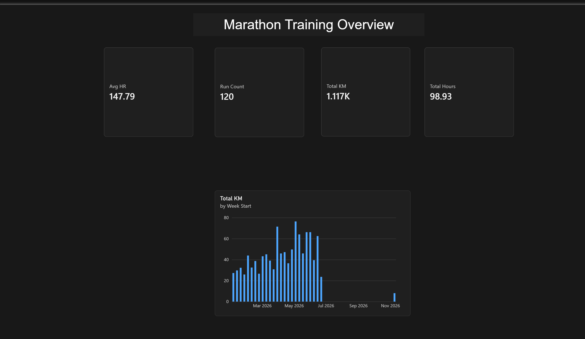
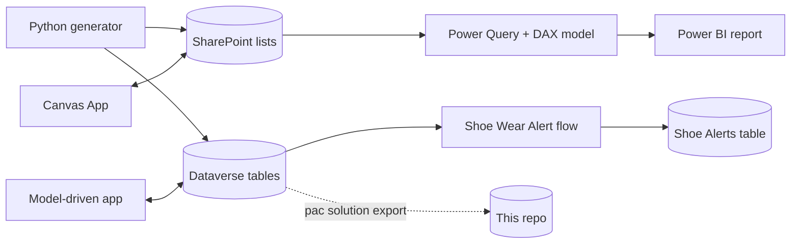
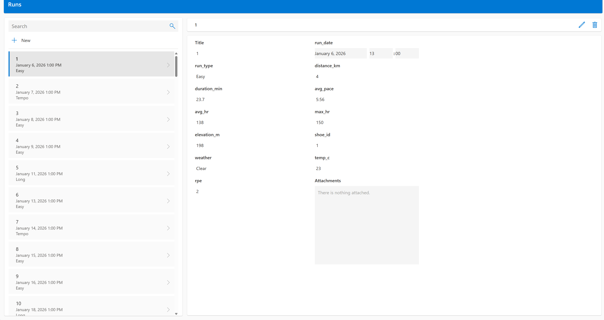
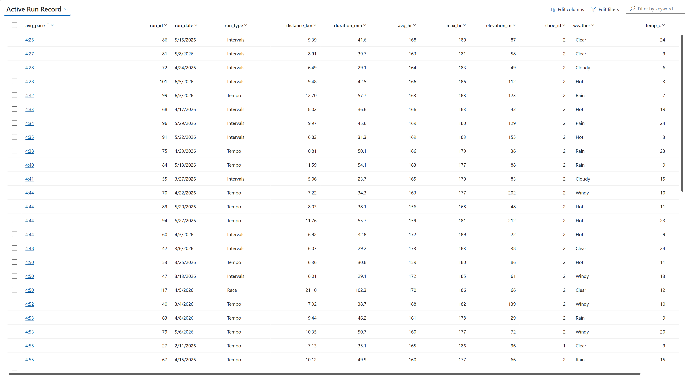
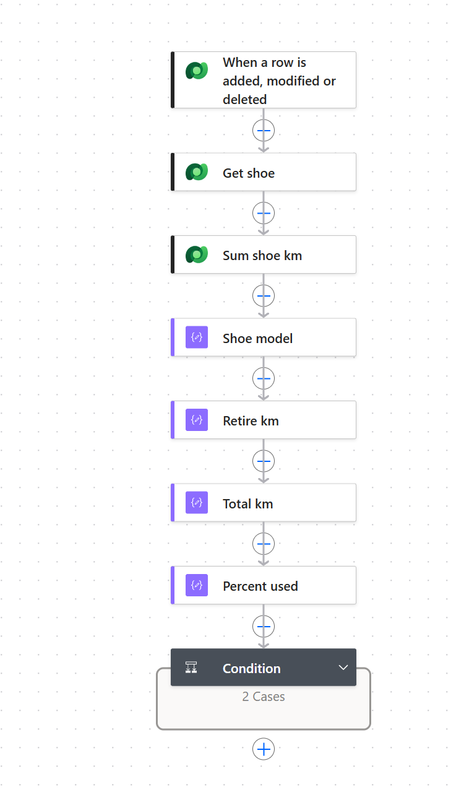
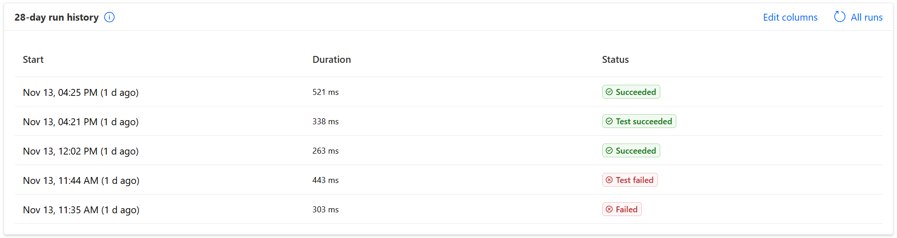

# Marathon Tracker

A Power Platform portfolio project: one data set (marathon training) used end to end across
Power Apps, Dataverse, SharePoint, Power Automate and Power BI, with the solution under source control.

> All data is synthetic, generated by a seeded Python script. No personal or health data is in this repo.

## What it does
| | |
|---|---|
| **Log a run** | Canvas App (phone) writes to a SharePoint list |
| **Manage runs, shoes and races** | Model-driven app on Dataverse |
| **Get warned before shoes wear out** | Power Automate flow: when a run is saved, total the shoe's km and record an alert at 80% of its life |
| **See training progress** | Power BI report: weekly distance, totals, heart rate |



## How it fits together

Design decisions, trade-offs and the enterprise-scale target design: [docs/architecture.md](docs/architecture.md)

## Skills shown
| Area | Evidence in this repo |
|---|---|
| Canvas Apps, Power Fx | [docs/canvas-app.md](docs/canvas-app.md), `docs/screenshots/app-list.png` |
| Model-driven apps, Dataverse | [powerplatform/solution/src/](powerplatform/solution/src/) (tables, forms, views, app) |
| Power Automate | [docs/power-automate.md](docs/power-automate.md): Dataverse trigger, FetchXML aggregate, condition |
| SharePoint | Lists as the Canvas App and Power BI source |
| Power BI, Power Query, DAX | [powerbi/queries.pq](powerbi/queries.pq), [powerbi/measures.dax](powerbi/measures.dax), `powerbi/marathon-tracker.pbix` |
| Data modelling | Star schema: [docs/data-model.md](docs/data-model.md) |
| ALM and version control | Solution `MarathonTracker` exported and unpacked with the Power Platform CLI |
| Lakehouse / warehouse, Fabric, AI | Target design only: [docs/architecture.md](docs/architecture.md#6-target-architecture-at-enterprise-scale-design-not-built) |
| Troubleshooting, documentation | [Problems found and fixed](docs/architecture.md#5-problems-found-and-fixed), [docs/setup.md](docs/setup.md) decision log |

## Screens
| Canvas App | Model-driven app |
|---|---|
|  |  |

| Flow | Flow run history |
|---|---|
|  |  |

## The Shoe Wear Alert flow
1. **Trigger:** a row is added to Runs (Dataverse).
2. **Get shoe:** look up the shoe used in that run.
3. **Sum shoe km:** one FetchXML aggregate, summed by Dataverse (no loop over runs).
4. **Percent used:** total km / retirement km.
5. **Condition:** at 80% or more, add a row to the Shoe Alerts table. The flow informs; a person decides.

Tested both ways: shoe 2 at 92.3% (553.82 of 600 km) wrote an alert row; shoe 1 at 24% did not.

## Repo layout
```
data/generated/        synthetic CSVs (reproducible: python scripts/generate_data.py)
data/raw/              real exports, git-ignored
scripts/               data generator
powerbi/               .pbix, Power Query (M), DAX measures, build guide
powerplatform/solution MarathonTracker solution: zip + unpacked source
docs/                  architecture, data model, setup and decision log, build guides, screenshots
```

## Run it yourself
```powershell
python scripts/generate_data.py                      # regenerate the CSVs
pac auth create                                       # sign in to a Dataverse environment
pac solution import --path powerplatform/solution/MarathonTracker_1_0_0_0.zip
```
Then load the CSVs into the tables (see [docs/setup.md](docs/setup.md)) and open `powerbi/marathon-tracker.pbix`.

## Known limits and next steps
- Two data stores (SharePoint and Dataverse) hold the same data; production would consolidate on Dataverse.
- The alert repeats on every run past 80%; next step is an `alert_sent` flag on Shoes.
- Not built: Power Pages, Fabric lakehouse/warehouse, Copilot Studio agent, multi-environment pipelines.
- Next: Run to Shoe lookup relationship, more report pages (Races, Recovery), real Strava/Garmin data in a separate table.
