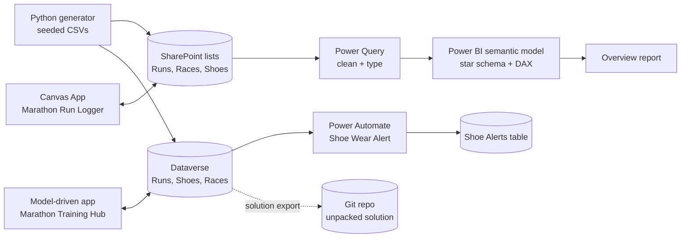
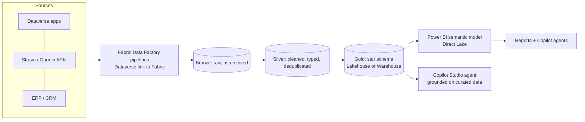

# Architecture and design decisions

## 1. What the solution does
A runner logs training runs, sees progress against a marathon plan, and is warned before shoes wear out.
The same data serves three audiences: the runner (apps), an analyst (Power BI) and automation (alerts).

## 2. As built

| Layer | Technology | Why |
|---|---|---|
| Data entry (mobile) | Canvas App on SharePoint | Standard connector, works on a Microsoft 365 licence |
| Data management | Model-driven app on Dataverse | Forms, views, search and security generated from the data model |
| Storage | SharePoint lists and Dataverse tables | See decision 1 |
| Automation | Power Automate cloud flow (Dataverse trigger) | Event-driven, runs when a run is saved |
| Analytics | Power BI: Power Query, star schema, DAX | Trusted measures in one semantic model |
| ALM | Solution `MarathonTracker`, exported and unpacked with `pac` | Diff-friendly source control |

## 3. Data model (star schema)
- **Facts:** Runs (one row per run), Races (one row per race), Recovery (one row per day)
- **Dimensions:** Date, Shoes, Plan (training week)
- Relationships are many-to-one, single direction, from facts to dimensions.
- Measures live in the semantic model, not in visuals (e.g. Total KM, ACWR, Shoe Life Used %).

Details: [data-model.md](data-model.md)

## 4. Decisions

### Decision 1: SharePoint first, Dataverse added later
- **Context:** the trial tenant could not provision Dataverse at first (no Power Apps plan).
- **Choice:** build the Canvas App and Power BI on SharePoint lists, which need no premium licence.
- **Later:** a Power Apps Premium trial unlocked a Developer environment, so Dataverse was added for the
  model-driven app, the flow and ALM.
- **Trade-off:** two stores hold the same data. In production I would consolidate on Dataverse
  (relationships, row-level security, auditing, solutions) and keep SharePoint for documents only.

### Decision 2: Event-driven alert with a server-side aggregate
- The flow triggers on "row added" rather than a schedule, so the alert follows the run that crosses the line.
- The shoe total is a FetchXML `sum` evaluated by Dataverse, so the flow makes one call instead of
  looping over every run. Fewer API calls, faster, and inside consumption limits.

### Decision 3: The flow records an alert, a person decides
- The flow writes a row to a Shoe Alerts table when a shoe reaches 80% of its life. It does not order anything.
- A table was chosen over email: the Mail connector is restricted on new tenants and Outlook was unreachable
  on the build day. The alert history is visible in the app, and an email or Teams step can follow it later.
- Known limitation: every run after 80% alerts again. Improvement: an `alert_sent` flag on Shoes.

### Decision 4: Time zones handled at each boundary
- CSV dates are date-only; SharePoint and Dataverse store date-times in UTC.
- Power Query converts UTC to NZ time before taking the date; the Dataverse user profile is set to Auckland.
- Lesson: decide per column whether it is a calendar date (time-zone independent) or a moment in time.

## 5. Problems found and fixed
| Problem | Cause | Fix |
|---|---|---|
| Only 20 of 119 rows loaded into Dataverse | "Upload file" keeps only its 20-row preview | Import the rest with "Import data from Excel" into the existing table |
| 15 rows rejected | Choice column options were inferred from the preview (no Intervals, Race) | Add the options, re-import those rows |
| Dates one day early | UTC storage shown in a US time zone | Set user time zone; convert in Power Query |
| Flow step returned empty | Typo in a column logical name (no error, just null) | Copy logical names from the table definition; inspect each step's output |
| Mail connector refused, Outlook timed out | Restricted on new tenants; Outlook unreachable | Write alerts to a Dataverse table instead |
| `pac` sign-in blocked | Security defaults block device-code flow | Interactive sign-in |

## 6. Target architecture at enterprise scale (design, not built)
What I would propose if this were a business system with many users and several source systems.

- **OneLake / Lakehouse:** bronze (raw), silver (cleaned), gold (dimensional) layers in Delta tables.
- **Pipelines and notebooks:** ingest and transform on a schedule; data quality checks between layers.
- **Warehouse vs Lakehouse:** Warehouse where teams work in T-SQL; Lakehouse where Spark and files dominate.
- **Semantic model:** one certified model with the measures, Direct Lake for freshness without import refreshes.
- **AI:** a Copilot Studio agent answers "how is my training load?" from the gold layer only, with the
  answer traceable to a measure, a usage cap, and a person deciding on any action.
- **Governance:** Dev, Test and Prod environments, managed solutions, deployment pipelines, DLP policies,
  least-privilege security roles, and sensitivity labels on health-related data.

## 7. What is and is not demonstrated
| Demonstrated in this repo | Designed only |
|---|---|
| Canvas App, model-driven app, Power Automate, Dataverse, SharePoint | Power Pages |
| Power Query, DAX, Power Fx, FetchXML | Fabric lakehouse, warehouse, pipelines |
| Star schema, solution export, Git | Azure SQL / Data Lake Storage |
| Troubleshooting and documentation | Copilot Studio agent, multi-environment deployment |
